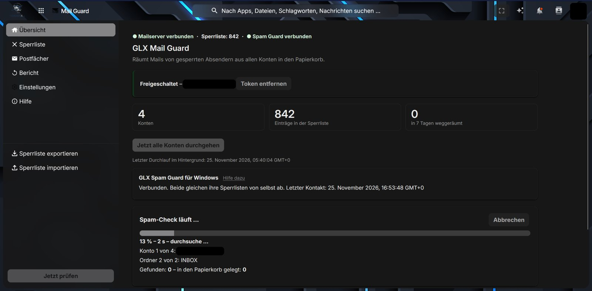
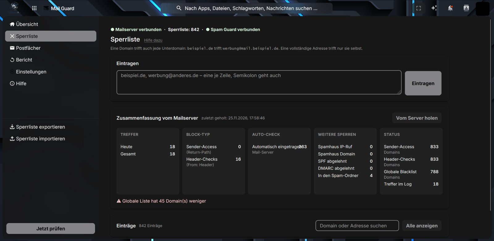
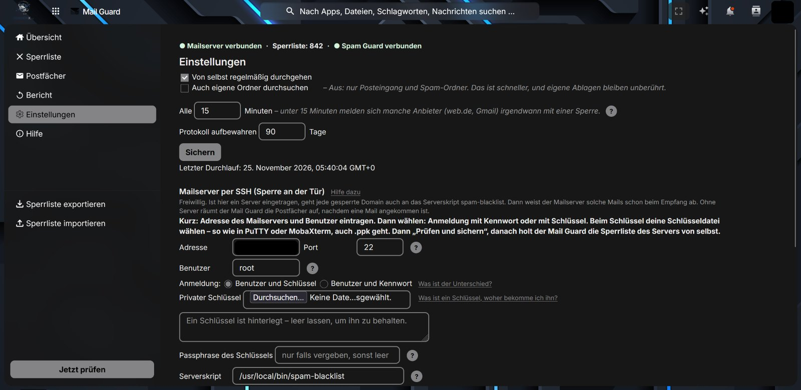
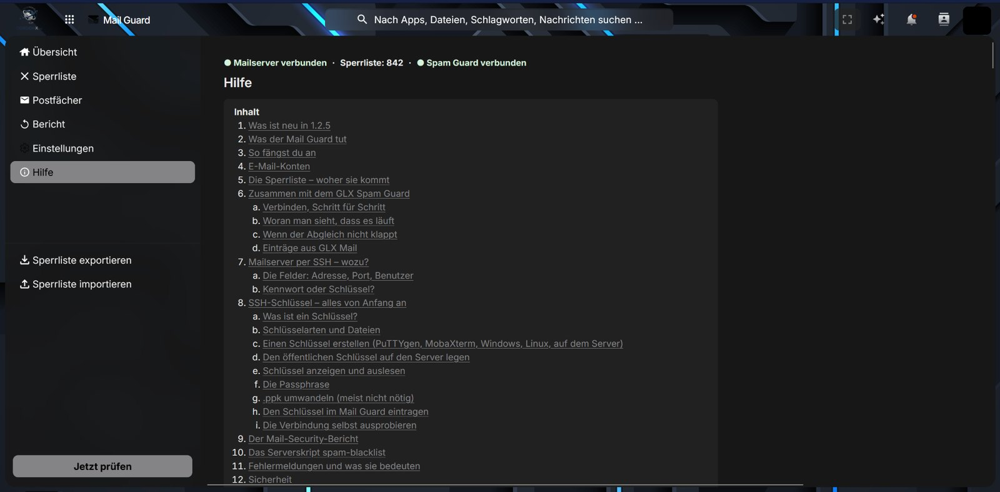

🌍 Languages: [🇺🇸 English](README.md) | [🇩🇪 Deutsch](README.de.md)

# 💠 GLX Mail Guard

### Your block list finally works everywhere.

*One block list for all Nextcloud Mail accounts and your own IMAP mailboxes.* ⚡

   

---

## ⬇️ Download

👉 Latest version: [Releases](../../releases/latest)  
👉 Shop and licences: [glx-tools.de](https://glx-tools.de/product/glx-mailguard/)

---

## 📖 About GLX Mail Guard

### Your block list finally works everywhere

A block list on your own mail server only protects the mailboxes behind that server, but Nextcloud Mail also fetches mail from Gmail, web.de or your club's mailbox. GLX Mail Guard applies one block list to every account: all Nextcloud Mail accounts and your own mailboxes via IMAP.

### Runs by itself, deletes nothing

GLX Mail Guard checks the mailboxes regularly on its own and moves matches to the trash. Nothing is deleted for good, and for every mail it notes which account it came from. With your own mail server it can also block domains there via SSH.

### Works together with GLX Mail and GLX Spam Guard

Entries come from GLX Mail with a right-click in the spam folder. The Windows companion GLX Spam Guard keeps the same list on your PC, and blocks and releases sync in both directions.

### No guessing

The app does not rate mail and does not learn. It only moves what a person put on the list. GLX Mail Guard is a Nextcloud app under AGPL for Nextcloud 30 to 34.

---

## 📸 Overview & Screenshots

### 1️⃣ Overview with licence, accounts and running spam check

### 2️⃣ Blocklist with summary from the mail server

### 3️⃣ Settings and mail server connection over SSH

### 4️⃣ Detailed built-in help

---

## ✨ Features

- 🚀 **One list for all accounts:** Applies your block list to every Nextcloud Mail account and your own IMAP mailboxes.
- 🧩 **Works on external providers:** Also protects mailboxes at Gmail, web.de and others that your mail server never sees.
- ⚙️ **Runs by itself:** Checks the mailboxes regularly in the background.
- 🔒 **Trash, not delete:** Matches are moved to the trash; nothing is deleted for good.
- 📂 **Traceable:** Notes for every moved mail which account it came from.
- ⚡ **Server-side blocking:** With your own mail server it can also block domains there via SSH.
- 🎨 **Entries from GLX Mail:** Block senders with a right-click in the spam folder of GLX Mail.
- 🌍 **Syncs with GLX Spam Guard:** The Windows companion keeps the same list; blocks and releases sync both ways.
- 🛠️ **No guessing:** No rating and no learning: only what a person put on the list is moved.
- 📊 **Open source:** Nextcloud app under AGPL, for Nextcloud 30 to 34.

---

## 🧩 Requirements

- Nextcloud 30 to 34
- Nextcloud Mail or IMAP mailboxes

---

## 🧪 Trial & License

Licence token from [glx-tools.de](https://glx-tools.de). The app is licensed under the AGPL-3.0-or-later.

---

## 🔗 More about this product

👉 [glx-tools.de](https://glx-tools.de/product/glx-mailguard/)  
For support: **info@glx-tools.de**

---

## 📄 License

Copyright © 2026 GLX Tools – Gordon Lehmann.  
This app is licensed under the AGPL-3.0-or-later.

---

Made with ❤️ by **Dreamdancer100**

